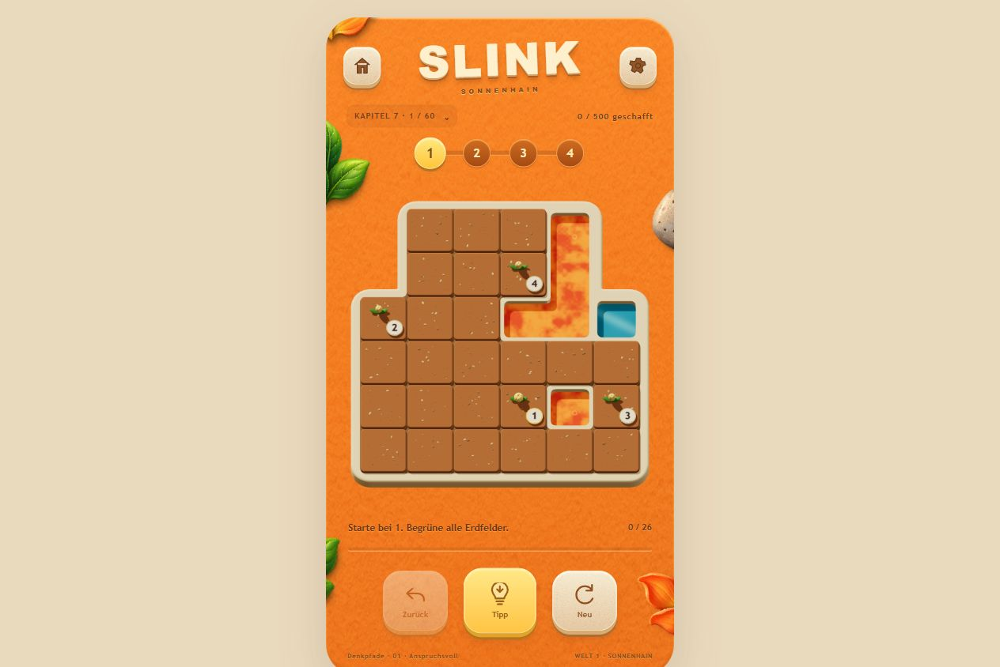

# SLINK

Ein spielbarer Browser-Prototyp für ein Smartphone-Puzzlespiel: Ein durchgehender Weg verwandelt Gartenerde in eine lebendige Kleewiese. Alle begehbaren Felder müssen besucht, die Zahlenziele in Reihenfolge gesammelt werden. Wasser, Lava und Stein bleiben Hindernisse.

## Aktueller Stand

**500 Rätsel in zehn Kapiteln**, ausgewählt aus 306.000 Kandidaten. Jede begehbare Form kommt nur einmal vor, auch nach Verschieben, Drehen oder Spiegeln. Alle Rätsel haben genau eine nachgewiesene Lösung und zwei bis vier Ziele.

| Kapitel | Level | Anzahl |
|---|---|---:|
| Erste Schritte | 1–30 | 30 |
| Gartenwege | 31–80 | 50 |
| Abzweigungen | 81–130 | 50 |
| Zwischen den Ufern | 131–180 | 50 |
| Schmale Pfade | 181–230 | 50 |
| Verborgene Wege | 231–290 | 60 |
| Denkpfade | 291–350 | 60 |
| Verschlungene Gärten | 351–410 | 60 |
| Meistergärten | 411–470 | 60 |
| Die letzte Lichtung | 471–500 | 30 |

Die Reihenfolge beruht auf Entscheidungsmöglichkeiten, verzögerten Fehlwegen, vorgegebenen Schritten und Suchaufwand. Das Engstellen-Kapitel enthält 50 echte Verbindungen zwischen jeweils mindestens vier Felder großen Bereichen. Die menschliche Schwierigkeit ist noch nicht kalibriert; die Auswahl benötigt weitere Spieltests.



## Spielen

Die bereits gebauten Browserdateien in `public` funktionieren ohne Build:

```sh
npm start
```

Anschließend `http://localhost:48321/slink.html` öffnen. Falls der Port bereits belegt ist, den laufenden Server verwenden oder `PORT` ändern. Der Server bindet standardmäßig nur an localhost.

- Haus-Symbol oder Kapitelanzeige: alle Kapitel und Rätsel frei auswählen.
- Zahnrad: Markengröße 27 %, 33 % oder 40 % wählen. Auswahl wird lokal gespeichert und verändert den aktuellen Weg nicht.
- Zahnrad → „Dieses Rätsel bewerten“: Schwierigkeitseindruck und Notiz lokal festhalten. „Bewertungen zusammenstellen“ zeigt die gesammelten Daten zum Kopieren.
- Der neue Katalog verwendet eigenen Fortschritt. Die bisherigen 112 Rätsel bleiben unter `archiv-112.html` erhalten; die zwölf Denkpfade unter `denkpfade.html`.
- Die Abschlussmeldung wartet 3,2 Sekunden. Rückgängig und Neustart verhindern eine verspätete Meldung.

Derzeit wird das zuletzt ausgewählte Level und der Abschlussfortschritt gespeichert, nicht ein unvollständiger gezogener Weg über ein Neuladen hinweg. Bewertungen bleiben auf dem jeweiligen Browser/Gerät und werden nicht an einen Server übertragen.

## Entwicklung

Node.js ab Version 20:

```sh
npm ci
npm run build
npm test
```

Rendererquellen: `src/renderer`. Browserseiten, gebaute Bundles, Texturen, Studien und Daten: `public`. Kein CDN ist zum Spielen erforderlich.

```sh
npm run catalogue:generate
```

Erzeugt reproduzierbar die Kandidatenpools in `work`, wählt den Katalog aus, prüft die Lösungen und installiert die Daten. Mit vorhandenen passenden Pools: `npm run catalogue:generate -- --reuse`. Rohpools und `node_modules` gehören nicht in Git. Vor einem geänderten Katalog stabile Puzzle-IDs und Fortschrittsmigration berücksichtigen.

## Materialien und Studien

Alle bisherigen Module und Varianten bleiben im Fundus. Einstiegspunkte:

- `elfenbeinwerkstatt.html`: separate Studie mit dickeren, runderen Creme-Rahmen ([Modulhinweise](docs/ivory-frame.md)).
- `materialwerkstatt.html`: ursprüngliche Terrainmodule und Rahmen.
- `wachstumswerkstatt.html`, `materialvergleich.html`: Erd- und Wiesenkombinationen.
- `fluessigkeitsvarianten.html`: ruhige Wasser- und Lavaanimationen.
- `wiesenvielfalt.html`: identischer Grundfarbton, unterschiedlicher Bewuchs.
- `zahlenmarken.html`, `zahlenmarken-test.html`: Markengrößen und Positionen.

## Prüfung und Grenzen

[Prüfbericht](docs/verification.md) · [Katalogmetriken](public/catalogue-v1-report.json) · [Grafikdurchlauf](public/catalogue-render-report.json)

Die aktuelle Fassung ist ein Web-Prototyp, keine native Android-App. Echte Android-Geräte, Energiebedarf und längere menschliche Spieltests stehen noch aus. Technisch geprüfte Eindeutigkeit und Auswahlmetriken sind keine Garantie, dass alle 500 Rätsel für jeden Menschen gleichermaßen interessant oder schwer sind.

## Sicherung

Kanonisches Repository: https://github.com/heinrichheinrichson-bit/Slink. Fertige Änderungen werden dort in Git gesichert. Geheimnisse, lokale Bewertungen und Rohpools werden nicht eingecheckt. Hinweise für weitere Arbeiten stehen in `AGENTS.md`.
